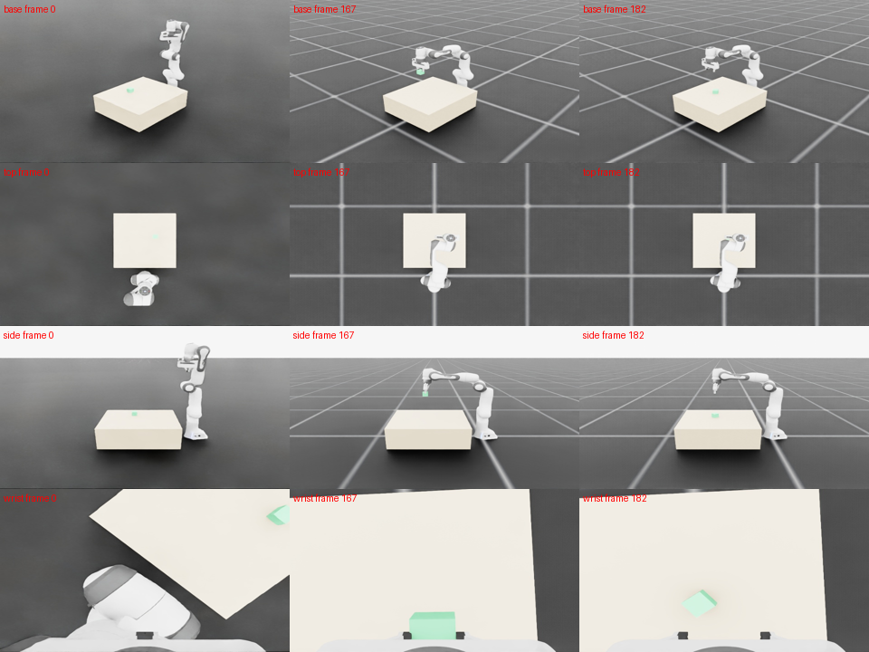

# Robot Data Generation

Independent planning and provenance for augmenting existing robot demonstrations.
**Research preview · Apache-2.0 original code.**

Read canonical `robot_data_episode` v1 files, validate sources, prepare deterministic
object-position retargeting plans, retain failed attempts, and compare paired
policy evaluations. No Studio server, database, UI or source checkout is required.

## Validated slice

**Official Panda · Isaac Sim 6.0.1 · PhysX · rigid_cube_lift**

- Nominal replay: **5/5 successes**.
- XY-retargeted generation: **7/10 successes**, all three failures retained.
- Ten attempts = five source demonstrations × two fixed offsets within +/-2 cm.
- All 15 Episodes, 3,407 frames and 13,628 camera images passed full readback.

Every candidate received fresh physics execution. Success requires closed-gripper
lift >=8 cm; hold/release are separate diagnostics. These results validate this
bounded executor/asset/task path, not policy improvement, broad generalization or
real-robot operation. Evidence review: `SELF_REVIEWED_PROVISIONAL`.

[Validation](docs/VALIDATION.md) · [Public experiment report](evidence/physics_batch_001/REPORT.md) ·
[Per-attempt outcomes](evidence/physics_batch_001/attempts.json)

Successful retargeted attempt:

[](evidence/physics_batch_001/randomized-success.mp4)

[Success video](evidence/physics_batch_001/randomized-success.mp4) ·
[Failure video](evidence/physics_batch_001/randomized-failure.mp4)

These videos show saved fresh simulator execution. They are H.264/yuv420p/faststart
and fully decoded locally; playback in a particular client is not guaranteed.

## Install

From a complete checkout, create your own environment:

```bash
python3 -m venv .venv
.venv/bin/python -m pip install ./packages/robot-data-contracts .
```

The protocol dependency is supplied as a standalone source package **in this
checkout**. No Studio clone, Git submodule, third repository or unpublished PyPI
package is required. NumPy/Pydantic and build dependencies may be downloaded by
pip. See [protocol distribution and compatibility](docs/CONTRACTS.md).
Python >=3.10 is declared; tested interpreters and installation limits are in
[validation](docs/VALIDATION.md). Isaac/GELLO/robot SDKs are external and are not
installed by this command.

## CPU example

```bash
.venv/bin/python examples/make_synthetic_episode.py --output outputs/synthetic
.venv/bin/robot-data-generation plan --config outputs/synthetic/config.json --output outputs/plan.json
.venv/bin/robot-data-generation plan --config outputs/synthetic/config.json --output outputs/nominal.json --nominal
.venv/bin/robot-data-generation plan-evaluation --m2-plan outputs/plan.json --output outputs/heldout.json --plan-id example-heldout --count 5
```

Use a new output directory. This creates a 12-frame, camera-free **synthetic schema
fixture** and four planned attempts, not four executed Episodes. Its teleoperation
lineage and success flags deliberately satisfy loader eligibility checks; the
control source and provenance disclose `synthetic_fixture` and
`physics_executed=false`. Never count this fixture as human or physical evidence.

For real sources, provide Episode paths and UUIDs using the
[configuration template](configs/README.md). Physical execution requires the
[external executor and verified robot asset](docs/EXECUTOR.md).

## Responsibility boundaries

| Component | Responsibility |
| --- | --- |
| Generation | Source validation, grasp-phase segmentation, waypoint retargeting, deterministic plans, resumable reports, training selection and diagnostics |
| robot-data-contracts | Independently installed Episode v1 schemas, reader and writer |
| External executor | Robot FK/IK, control safety, fresh physics, sensing, native evaluation and recording |
| Studio (optional) | A producer/consumer of the same Episode files; no runtime dependency |

The planning slice assumes Franka absolute joint8 actions and cube XY translation.
Cloth rerendering, internal renderer scripts, real hardware control, model training
and simulator installation are outside this preview.

## Earlier evidence

A historical study recorded 79/100 lift successes in the same configured XY range.
Its paired policy comparison was 0/20 versus 1/20 (exact McNemar p=1.0), which does
not establish policy improvement. [Historical summary](evidence/historical_summary.json)
is separate from the new standalone-package validation above.

## License and provenance

Original contributions the contributors are authorized to license are provided
under [Apache-2.0](LICENSE). See [NOTICE](NOTICE) and
[THIRD_PARTY_NOTICES.md](THIRD_PARTY_NOTICES.md). The bundled protocol package
preserves its existing license and attribution. External SDKs, assets, models and
dependencies retain their own terms; the project license does not relicense them.

[Source snapshot](docs/SOURCE_SNAPSHOT.json) records the unchanged core's origin.
No original datasets, checkpoints, simulator assets, private logs or Git history
are included. See [release scope](docs/RELEASE_SCOPE.md) for the public/private boundary.
